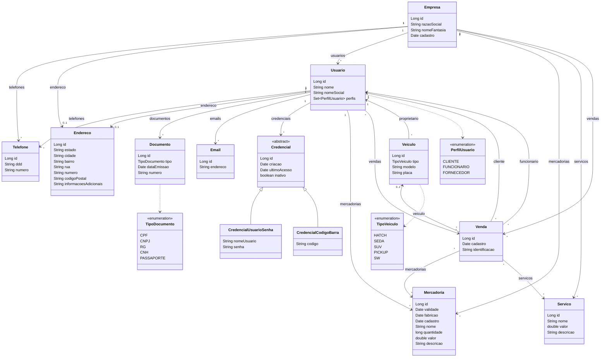

# AutoManager — API AutoBots

[](https://github.com/Clown0o0/AV3-dswIII/actions/workflows/ci.yml)


> API REST em **Spring Boot** da AutoBots para gestão de lojas de manutenção veicular e venda de autopeças: empresas, usuários (clientes, funcionários e fornecedores), credenciais, veículos, mercadorias, serviços e vendas.

---

## Sumário

1. [Objetivo](#objetivo)
2. [Organização do código](#organização-do-código)
3. [Executando localmente](#executando-localmente)
4. [Passo a passo de uso da API](#passo-a-passo-de-uso-da-api)
5. [Níveis de maturidade (RMM)](#níveis-de-maturidade-rmm)
6. [Rotas](#rotas)
7. [Links HATEOAS](#links-hateoas)
8. [Exemplo de requisição](#exemplo-de-requisição)
9. [Exemplo de resposta](#exemplo-de-resposta)
10. [Validações e erros](#validações-e-erros)
11. [Documentação (Swagger)](#documentação-swagger)
12. [Diagrama das entidades](#diagrama-das-entidades)
13. [Notas](#notas)
14. [Autor](#autor)

---

## Objetivo

Atividade ATVIII ("atualização de base"): implementar o novo diagrama de classes do AutoManager, com CRUD e HATEOAS para todas as entidades, seguindo as práticas de back-end vistas em aula:

- [x] Arquitetura em camadas (Controller → Service → Repository)
- [x] DTOs de entrada com Bean Validation, grupos de validação (`Criacao`/`Atualizacao`/`Vinculo`) e anotações customizadas (`@Placa`, `@DocumentoValido`, `@DonoUnico`)
- [x] Exceções customizadas tratadas em `@RestControllerAdvice`, com corpo de erro padronizado (`ErroRespostaDTO`)
- [x] Relacionamentos JPA/Hibernate do diagrama (empresa, usuário com vários perfis, credencial polimórfica, veículo, mercadoria, serviço e venda)
- [x] Os 4 níveis do Richardson Maturity Model (RMM), incluindo HATEOAS com Spring HATEOAS
- [x] Documentação OpenAPI com Swagger UI (springdoc-openapi)

A "atualização de segurança" (Spring Security, JWT, perfis de acesso e hash de senha) fica para a próxima etapa.

## Organização do código

```
com.autobots.automanager
├── controles      # endpoints REST (@RestController + @Tag/@Operation)
├── service        # regras de negócio (@Service + @Validated)
├── repositorios   # acesso a dados (Spring Data JPA)
├── entidades      # modelos persistidos (estendem RepresentationModel)
├── enumeracoes    # PerfilUsuario, TipoDocumento, TipoVeiculo
├── dto            # objetos de entrada e ErroRespostaDTO
│   └── validacao  # grupos e anotações de validação customizadas
├── modelo         # AdicionadorLink* (HATEOAS) e *Atualizador (atualização parcial)
├── exception      # exceções customizadas e handler global
└── configuracao   # OpenApiConfig
```

## Executando localmente

### Como funciona

- A API é uma aplicação Spring Boot que, ao subir, abre um servidor web na porta `8080`.
- Cada requisição HTTP passa por três camadas. O **controle** recebe e valida o JSON, o **service** aplica as regras de negócio e o **repositório** (Spring Data JPA) conversa com o banco. A resposta volta em JSON com `_links` (HATEOAS) apontando para as próximas ações possíveis.
- O banco é o MySQL por padrão, ou o H2 em memória. As tabelas são recriadas a cada inicialização (`create-drop`), então os dados **não** ficam salvos de uma execução para a outra.
- Ao subir, a aplicação cadastra dados de exemplo (empresa, funcionária, cliente, veículo, mercadoria, serviço e venda), para você já ter o que consultar.
- O Swagger UI, em `/swagger-ui/index.html`, permite testar todas as rotas pelo navegador.

### O que instalar antes

| Ferramenta | Para quê | Onde baixar | Como conferir |
| ---------- | -------- | ----------- | ------------- |
| **JDK 17 ou superior** | compilar e rodar a API | [adoptium.net](https://adoptium.net) (Temurin 17 LTS; no instalador do Windows, marque *Set JAVA_HOME variable*) | `java -version` deve mostrar 17 ou mais. O `JAVA_HOME` deve apontar para a pasta do JDK: `echo $env:JAVA_HOME` (PowerShell), `echo %JAVA_HOME%` (CMD) ou `echo $JAVA_HOME` (Linux/macOS) |
| **Git** | clonar o repositório | [git-scm.com](https://git-scm.com) | `git --version` |
| **MySQL 8** | banco de dados padrão | [dev.mysql.com/downloads/mysql](https://dev.mysql.com/downloads/mysql/) | `mysql --version`. Anote o **usuário**, a **senha** e a **porta** (padrão `3306`) definidos na instalação |

> **Sem MySQL?** Ele pode ser trocado pelo H2 em memória, sem instalar nenhum banco (veja [Rodando sem MySQL (H2)](#rodando-sem-mysql-h2)).
>
> No Windows, o instalador do MySQL não coloca o `mysql` no PATH. Se `mysql --version` não for reconhecido, use o caminho completo: `& "C:\Program Files\MySQL\MySQL Server 8.0\bin\mysql.exe" --version`.

**O que você NÃO precisa instalar:**

- **Maven**: o projeto traz o Maven Wrapper (`mvnw` no Linux/macOS, `mvnw.cmd` no Windows). Na primeira execução, ele baixa o Maven 3.8.4 e todas as dependências para a pasta `~/.m2`, por isso **a primeira execução precisa de internet** e pode levar alguns minutos. As seguintes são rápidas.
- **Node.js / npm**: o projeto não usa. O Swagger UI já vem dentro da aplicação.
- **IDE**: é opcional. Tudo roda pelo terminal.

### Passo a passo

Os comandos abaixo foram testados no Windows (PowerShell e CMD) e no Git Bash, com a mesma sintaxe do Linux/macOS.

**1) Clone o repositório e entre na pasta do projeto**

```bash
git clone https://github.com/Clown0o0/AV3-dswIII.git
cd AV3-dswIII/automanager
```

**2) Confira as versões**

```bash
java -version
git --version
mysql --version
```

O `mysql --version` só é necessário para quem vai usar o MySQL; quem for rodar com o [H2](#rodando-sem-mysql-h2) pode ignorar essa linha. Se `java -version` mostrar uma versão abaixo de 17, ou se o `mvnw` reclamar do `JAVA_HOME`, veja [Solução de problemas](#solução-de-problemas).

**3) Informe o usuário e a senha do seu MySQL** em `src/main/resources/application.properties` (dentro de `automanager`):

```properties
spring.datasource.url=jdbc:mysql://localhost:3306/av3DW3?createDatabaseIfNotExist=true
spring.datasource.username=root
spring.datasource.password=root
```

Troque `root`/`root` pelo usuário e pela senha do seu MySQL e, se ele não estiver na porta `3306`, troque a porta na URL. O banco `av3DW3` é criado automaticamente, e as tabelas são recriadas a cada inicialização (`ddl-auto=create-drop`).

> **Atenção:** o MySQL precisa estar **em execução antes** de subir a aplicação; caso contrário, ela falha com `Communications link failure`.
>
> - **Windows:** confira o serviço `MySQL80` (nome criado pelo instalador do MySQL 8.0) em `services.msc`, ou inicie com `net start MySQL80` num terminal aberto como administrador.
> - **Linux:** `sudo systemctl start mysql` (Debian/Ubuntu); no Fedora/RHEL, o serviço se chama `mysqld`.
> - **macOS:** pelo painel do MySQL nas Configurações do Sistema ou, se instalou pelo Homebrew, com `brew services start mysql`.
>
> Quem for usar o [H2](#rodando-sem-mysql-h2) pode pular este aviso.

**4) Suba a aplicação**

| Sistema | Comando (dentro de `automanager`) |
| ------- | --------------------------------- |
| Windows (PowerShell) | `.\mvnw.cmd spring-boot:run` |
| Windows (CMD) | `mvnw.cmd spring-boot:run` |
| Linux / macOS / Git Bash | `./mvnw spring-boot:run` |

No Linux/macOS, se aparecer `permission denied: ./mvnw`, rode `chmod +x mvnw` uma vez e repita.

Pela IDE, também dá para executar a classe `AutomanagerApplication`.

A aplicação está pronta quando aparecerem estas duas linhas:

```
... o.s.b.w.embedded.tomcat.TomcatWebServer  : Tomcat started on port(s): 8080 (http) with context path ''
... c.a.automanager.AutomanagerApplication   : Started AutomanagerApplication in 6.633 seconds (JVM running for 6.939)
```

Logo depois dessa mensagem, os dados de exemplo são gravados (aguarde um ou dois segundos antes do primeiro teste). Para parar a aplicação, use `Ctrl+C`.

**5) Teste com o curl**

| Sistema | Comando |
| ------- | ------- |
| Windows (PowerShell) | `curl.exe http://localhost:8080/empresas` |
| Windows (CMD), Linux, macOS, Git Bash | `curl http://localhost:8080/empresas` |

> No Windows PowerShell 5.1, `curl` é um apelido do `Invoke-WebRequest`, e não o curl de verdade. Por isso é preciso escrever `curl.exe`.

A resposta traz os dados de exemplo cadastrados ao iniciar: a empresa **AutoBots São José** (com telefone e endereço), a funcionária **Carla Mendes**, o cliente **Dom Pedro** (com CPF, RG, telefone, endereço, e-mail e credencial), o veículo dele (Jeep Compass `BRA2E19`), uma mercadoria, um serviço e a venda `VND-2026-0001` ligando tudo. Trecho da resposta real (`200 OK`):

```json
{
  "_embedded": {
    "empresas": [
      {
        "id": 1,
        "razaoSocial": "AutoBots Comércio de Autopeças Ltda",
        "nomeFantasia": "AutoBots São José",
        "telefones": [
          {
            "id": 1, "ddd": "12", "numero": "3941-2000",
            "_links": { "self": { "href": "http://localhost:8080/telefones/1" }, "...": "..." }
          }
        ],
        "endereco": { "id": 1, "estado": "São Paulo", "cidade": "São José dos Campos", "...": "..." },
        "cadastro": "29/10/2026 22:42",
        "mercadorias": [ { "id": 1, "nome": "Pastilha de freio dianteira", "quantidade": 40, "valor": 189.9, "...": "..." } ],
        "servicos": [ { "id": 1, "nome": "Troca de pastilhas de freio", "valor": 120.0, "...": "..." } ],
        "_links": {
          "self": { "href": "http://localhost:8080/empresas/1" },
          "empresas": { "href": "http://localhost:8080/empresas" },
          "atualizar": { "href": "http://localhost:8080/empresas/1" },
          "excluir": { "href": "http://localhost:8080/empresas/1" },
          "usuarios": { "href": "http://localhost:8080/empresas/1/usuarios" },
          "novo-usuario": { "href": "http://localhost:8080/empresas/1/usuarios" },
          "mercadorias": { "href": "http://localhost:8080/empresas/1/mercadorias" },
          "servicos": { "href": "http://localhost:8080/empresas/1/servicos" },
          "vendas": { "href": "http://localhost:8080/empresas/1/vendas" }
        }
      }
    ]
  },
  "_links": { "self": { "href": "http://localhost:8080/empresas" } }
}
```

**6) Abra a documentação** em [http://localhost:8080/swagger-ui/index.html](http://localhost:8080/swagger-ui/index.html). Pelo Swagger dá para testar todas as rotas no navegador, inclusive com acentos, sem usar o curl.

> Requer **JDK 17** ou superior (testado no 17 e no 26). O `pom.xml` fixa o Lombok em `1.18.46` e o registra em `annotationProcessorPaths`, necessário a partir do JDK 23, que não executa mais annotation processors do classpath automaticamente.

### Rodando sem MySQL (H2)

Para usar um banco H2 em memória, sem instalar banco e sem alterar o `application.properties`, passe as propriedades na linha de comando (dentro de `automanager`). Os dados somem quando a aplicação para.

Windows (PowerShell ou CMD; no CMD, use `mvnw.cmd` sem o `.\`):

```powershell
.\mvnw.cmd spring-boot:run "-Dspring-boot.run.arguments=--spring.datasource.url=jdbc:h2:mem:automanager --spring.datasource.driver-class-name=org.h2.Driver --spring.datasource.username=sa --spring.datasource.password="
```

Linux / macOS / Git Bash:

```bash
./mvnw spring-boot:run "-Dspring-boot.run.arguments=--spring.datasource.url=jdbc:h2:mem:automanager --spring.datasource.driver-class-name=org.h2.Driver --spring.datasource.username=sa --spring.datasource.password="
```

Também dá para gerar o jar e rodá-lo direto:

```bash
./mvnw clean package
java -jar target/automanager-0.0.1-SNAPSHOT.jar --spring.datasource.url=jdbc:h2:mem:automanager --spring.datasource.driver-class-name=org.h2.Driver --spring.datasource.username=sa --spring.datasource.password=
```

### Testes automatizados

`.\mvnw.cmd clean package` (Windows) ou `./mvnw clean package` (Linux/macOS) roda os testes com H2 em memória, configurado por `@TestPropertySource`; não é preciso ter MySQL. A mesma suíte também passou contra um MySQL 8.0.46 real, numa cópia do projeto com o `@TestPropertySource` apontando para ele. A classe `ControlesTests` (MockMvc) cobre:

- **CRUD de todos os recursos** (empresa, usuário, telefone, endereço, documento, e-mail, credencial usuário/senha, credencial código de barras, mercadoria, serviço, veículo e venda): `POST` (`201` + `Location`), `GET` lista (`200`, `_embedded`), `GET` por id (`200`), `PUT` parcial (`200`), `DELETE` (`204`) e `GET` após `DELETE` (`404` com `ErroRespostaDTO`), sempre conferindo `_links.self`, a coleção, `atualizar`, `excluir` e os links para os relacionados.
- **Fluxo completo**: empresa → usuário criado dentro da empresa → usuário vinculado depois → veículo → mercadoria → serviço → venda, seguindo `_links.cliente` da venda e conferindo `/usuarios/{id}/vendas`, `/veiculos/{id}/vendas`, `/empresas/{id}/vendas` e o desvínculo do usuário.
- **Regras da venda**: cliente sem perfil `CLIENTE`, funcionário sem perfil `FUNCIONARIO`, veículo de outro dono, venda sem itens (`400`), identificação duplicada (`409`) e participante inexistente (`404`).
- **POST inválido** (`400` com `mensagem`, `status` e `campos`): obrigatórios por grupo, placa fora do padrão (`@Placa`), CPF com dígito verificador errado (`@DocumentoValido`), item sem dono (`@DonoUnico`), data no futuro, e-mail inválido, enum/tipo de credencial inexistente, valores negativos e id não numérico.
- **Exclusão de registro referenciado** (`409`): usuário com vendas/veículos, veículo com vendas, mercadoria e serviço presentes em venda e empresa com usuários; depois de excluir a venda, a exclusão em cadeia passa a responder `204`.
- **Sem recursão e sem senha no JSON**: venda, veículo e usuário não trazem agregados aninhados, e nenhuma listagem contém `senha` nem o valor da senha.
- **OpenAPI**: `/v3/api-docs` responde `200` com `info.title = "AutoManager API"`, e `/swagger-ui/index.html` responde `200`.

### Solução de problemas

| Sintoma | Causa | O que fazer |
| ------- | ----- | ----------- |
| `Error: JAVA_HOME not found in your environment.` ou `Error: JAVA_HOME is set to an invalid directory.` | `JAVA_HOME` ausente ou apontando para uma pasta errada | Aponte o `JAVA_HOME` para a pasta do JDK 17+ (ex.: `C:\Program Files\Eclipse Adoptium\jdk-17...`) e **abra um terminal novo** |
| `java -version` mostra 8 ou 11, ou o build falha com `release version 17 not supported` | Java antigo no PATH/`JAVA_HOME` | Instale o JDK 17+ e ajuste o `JAVA_HOME` e o PATH para ele |
| `Web server failed to start. Port 8080 was already in use.` | Outro programa usa a porta 8080 | Suba em outra porta: `.\mvnw.cmd spring-boot:run "-Dspring-boot.run.arguments=--server.port=8081"` (ou `./mvnw ...` no Linux/macOS); com o jar, acrescente `--server.port=8081` |
| `Communications link failure` | O MySQL não está rodando ou está em outra porta | Inicie o MySQL (no Windows, serviço `MySQL80` em `services.msc`), confira a porta na URL do `application.properties` ou use o [H2](#rodando-sem-mysql-h2) |
| `Access denied for user 'root'@'localhost'` | Usuário ou senha do MySQL errados | Corrija `spring.datasource.username` e `spring.datasource.password` no `application.properties` |
| A primeira execução demora vários minutos | O wrapper está baixando o Maven e as dependências | É normal e precisa de internet só na primeira vez; as seguintes usam o cache em `~/.m2` |
| Erro ao baixar de `repo.maven.apache.org` (ex.: `Could not transfer artifact`, `Connection timed out`, `Unknown host`) | A rede bloqueia o repositório Maven Central ou exige proxy (comum em redes corporativas ou de faculdade) | Teste em outra rede ou configure o proxy em `~/.m2/settings.xml` e repita o comando |
| `permission denied: ./mvnw` (Linux/macOS) | O arquivo perdeu a permissão de execução | `chmod +x mvnw` |
| No Windows, o `curl` com acentos no `-d '...'` responde `400` ("Corpo da requisição inválido ou mal formatado") | O console converte os acentos para outra página de código; no PowerShell 5.1, as aspas internas do JSON também se perdem | Grave o JSON num arquivo e envie com `curl.exe ... -d "@arquivo.json"` (no PowerShell, o `@arquivo` precisa estar entre aspas; no CMD, `-d @arquivo.json`), use o Git Bash ou use o Swagger UI |

## Passo a passo de uso da API

Comandos executados com a aplicação recém-iniciada (H2) e respostas reais. Os ids partem de `2` porque o primeiro registro de cada recurso é o dos dados de exemplo. Os `_links` aparecem resumidos com `"...": "..."` onde se repetem.

Os comandos desta seção usam a sintaxe do **bash** (Linux, macOS, Git Bash ou WSL), com o JSON entre aspas simples. No Windows PowerShell ou CMD, esse formato não funciona: grave o JSON num arquivo e envie com `curl.exe ... -d "@arquivo.json"` (veja [Solução de problemas](#solução-de-problemas)), ou use o Swagger UI.

> **Acentos no `curl` do Windows**: o `curl` converte o texto de `-d '...'` para a página de código do console, e a API responde `400` ("Corpo da requisição inválido ou mal formatado") se o JSON tiver acentos. Por isso os exemplos abaixo não usam acentos. Para enviar acentos, grave o JSON num arquivo UTF-8 e use `-d @arquivo.json`, ou use o Swagger UI.

**1) Cadastrar a empresa**

```bash
curl -i -X POST http://localhost:8080/empresas -H "Content-Type: application/json" -d '{"razaoSocial":"Auto Pecas Vale do Paraiba Ltda","nomeFantasia":"AutoBots Taubate","telefones":[{"ddd":"12","numero":"3622-4000"}],"endereco":{"estado":"SP","cidade":"Taubate","bairro":"Centro","rua":"Rua Quatro de Marco","numero":"432","codigoPostal":"12020-270","informacoesAdicionais":"Loja 2"}}'
```

```
HTTP/1.1 201
Location: http://localhost:8080/empresas/2
```

**2) Cadastrar o funcionário já dentro da empresa** e **o cliente** (vinculado por `empresaId`)

```bash
curl -i -X POST http://localhost:8080/empresas/2/usuarios -H "Content-Type: application/json" -d '{"nome":"Marcos Oliveira","perfis":["FUNCIONARIO"],"emails":[{"endereco":"marcos.oliveira@autobots.com.br"}]}'
```

```
HTTP/1.1 201
Location: http://localhost:8080/usuarios/3
```

```bash
curl -i -X POST http://localhost:8080/usuarios -H "Content-Type: application/json" -d '{"nome":"Helena Duarte","nomeSocial":"Helena","perfis":["CLIENTE"],"empresaId":2,"documentos":[{"tipo":"CPF","numero":"39053344705","dataEmissao":"2012-08-20"}],"telefones":[{"ddd":"12","numero":"99654-3210"}],"endereco":{"estado":"SP","cidade":"Taubate","bairro":"Independencia","rua":"Avenida Italia","numero":"1500","codigoPostal":"12030-212"},"emails":[{"endereco":"helena.duarte@email.com"}]}'
```

```
HTTP/1.1 201
Location: http://localhost:8080/usuarios/4
```

Um usuário pode ter mais de um perfil (ex.: `"perfis":["CLIENTE","FORNECEDOR"]`). Um usuário existente também pode ser vinculado depois com `PUT /empresas/2/usuarios/{usuarioId}`.

**3) Criar a credencial do cliente** (o campo `tipo` escolhe a subclasse: `usuarioSenha` ou `codigoBarra`)

```bash
curl -X POST http://localhost:8080/credenciais -H "Content-Type: application/json" -d '{"tipo":"usuarioSenha","nomeUsuario":"helena.duarte","senha":"minhaSenha123","usuarioId":4}'
```

`201 Created`. A senha é aceita na entrada, mas nunca volta no JSON:

```json
{
  "tipo": "usuarioSenha",
  "id": 3,
  "criacao": "29/10/2026 22:42",
  "ultimoAcesso": null,
  "inativo": false,
  "nomeUsuario": "helena.duarte",
  "_links": {
    "self": { "href": "http://localhost:8080/credenciais/3" },
    "credenciais": { "href": "http://localhost:8080/credenciais" },
    "atualizar": { "href": "http://localhost:8080/credenciais/3" },
    "excluir": { "href": "http://localhost:8080/credenciais/3" },
    "usuario": { "href": "http://localhost:8080/usuarios/4" }
  }
}
```

Para inativar: `curl -X PUT http://localhost:8080/credenciais/3 -H "Content-Type: application/json" -d '{"tipo":"usuarioSenha","inativo":true}'` → `200 OK` com `"inativo": true`.

**4) Cadastrar o veículo do cliente**

```bash
curl -X POST http://localhost:8080/veiculos -H "Content-Type: application/json" -d '{"tipo":"HATCH","modelo":"Volkswagen Polo","placa":"FTA3C45","proprietarioId":4}'
```

`201 Created` (`Location: http://localhost:8080/veiculos/2`):

```json
{
  "id": 2,
  "tipo": "HATCH",
  "modelo": "Volkswagen Polo",
  "placa": "FTA3C45",
  "_links": {
    "self": { "href": "http://localhost:8080/veiculos/2" },
    "veiculos": { "href": "http://localhost:8080/veiculos" },
    "atualizar": { "href": "http://localhost:8080/veiculos/2" },
    "excluir": { "href": "http://localhost:8080/veiculos/2" },
    "proprietario": { "href": "http://localhost:8080/usuarios/4" },
    "vendas": { "href": "http://localhost:8080/veiculos/2/vendas" }
  }
}
```

**5) Cadastrar a mercadoria e o serviço da empresa**

```bash
curl -i -X POST http://localhost:8080/mercadorias -H "Content-Type: application/json" -d '{"nome":"Filtro de oleo","descricao":"Filtro para motor 1.0 TSI","validade":"2030-06-30","fabricao":"2026-03-01","quantidade":25,"valor":54.9,"empresaId":2}'
```

```
HTTP/1.1 201
Location: http://localhost:8080/mercadorias/2
```

```bash
curl -i -X POST http://localhost:8080/servicos -H "Content-Type: application/json" -d '{"nome":"Troca de oleo","descricao":"Oleo 5W30 sintetico e mao de obra","valor":150.0,"empresaId":2}'
```

```
HTTP/1.1 201
Location: http://localhost:8080/servicos/2
```

**6) Registrar a venda** informando tudo por id

```bash
curl -i -X POST http://localhost:8080/vendas -H "Content-Type: application/json" -d '{"identificacao":"VND-2026-0002","empresaId":2,"clienteId":4,"funcionarioId":3,"veiculoId":2,"mercadorias":[2],"servicos":[2]}'
```

```
HTTP/1.1 201
Location: http://localhost:8080/vendas/2
```

**7) Consultar a venda e seguir os `_links`**

```bash
curl http://localhost:8080/vendas/2
```

A resposta completa está em [Exemplo de resposta](#exemplo-de-resposta). A partir dela:

```bash
curl http://localhost:8080/usuarios/4          # _links.cliente
curl http://localhost:8080/usuarios/3          # _links.funcionario
curl http://localhost:8080/veiculos/2          # _links.veiculo
curl http://localhost:8080/usuarios/4/vendas   # _links.vendas do cliente
curl http://localhost:8080/empresas/2/usuarios # usuários da empresa (Marcos e Helena)
```

Todas respondem `200 OK`. `GET /usuarios/4` traz os perfis, os itens embutidos (telefone, endereço, CPF, e-mail e credencial **sem a senha**) e os links `empresa`, `veiculos`, `vendas` e `credenciais`.

**8) Regras em ação** (respostas reais)

```bash
# cliente sem o perfil CLIENTE (usuário 3 é funcionário)
curl -X POST http://localhost:8080/vendas -H "Content-Type: application/json" -d '{"identificacao":"VND-2026-0003","empresaId":2,"clienteId":3,"funcionarioId":3,"mercadorias":[2]}'
# 400 {"mensagem":"O usuário com o id 3 não possui o perfil CLIENTE","status":400}

# veículo de outro dono (veículo 1 é do Dom Pedro)
curl -X POST http://localhost:8080/vendas -H "Content-Type: application/json" -d '{"identificacao":"VND-2026-0003","empresaId":2,"clienteId":4,"funcionarioId":3,"veiculoId":1,"servicos":[2]}'
# 400 {"mensagem":"O veículo com o id 1 não pertence ao cliente com o id 4","status":400}

# identificação repetida
curl -X POST http://localhost:8080/vendas -H "Content-Type: application/json" -d '{"identificacao":"VND-2026-0002","empresaId":2,"clienteId":4,"funcionarioId":3,"servicos":[2]}'
# 409 {"mensagem":"Já existe uma venda com a identificação VND-2026-0002","status":409}

# excluir registro referenciado
curl -X DELETE http://localhost:8080/usuarios/4
# 409 {"mensagem":"O usuário com o id 4 possui 1 venda(s) registrada(s) e não pode ser excluído","status":409}
curl -X DELETE http://localhost:8080/mercadorias/2
# 409 {"mensagem":"A mercadoria com o id 2 faz parte de uma venda e não pode ser excluída","status":409}

# depois de excluir a venda, a mercadoria pode ser excluída
curl -X DELETE http://localhost:8080/vendas/2        # 204
curl -X DELETE http://localhost:8080/mercadorias/2   # 204
```

## Níveis de maturidade (RMM)

| Nível | Requisito                         | Como foi aplicado |
| ----- | --------------------------------- | ----------------- |
| 0     | Uso do protocolo HTTP             | API REST sobre HTTP com corpo JSON (HAL) |
| 1     | URI única por recurso             | `/empresas`, `/usuarios`, `/mercadorias`, `/servicos`, `/veiculos`, `/vendas`, `/telefones`, `/enderecos`, `/documentos`, `/emails`, `/credenciais`; cada registro em `/{recurso}/{id}` |
| 2     | Uso dos métodos e suas semânticas | `POST`, `GET`, `PUT`, `DELETE` com `ResponseEntity`: `201 Created` + header `Location`, `200 OK`, `204 No Content`, `400`, `404`, `409` |
| 3     | HATEOAS                           | Entidades estendem `RepresentationModel`; um `AdicionadorLink*` por entidade (pacote `modelo`) monta os links com `WebMvcLinkBuilder`; listagens devolvem `CollectionModel` |

## Rotas

Todos os recursos têm o mesmo CRUD:

| Verbo    | Caminho            | Descrição                         | Status |
| -------- | ------------------ | --------------------------------- | ------ |
| `POST`   | `/{recurso}`       | cadastra (dono/relacionados por id no corpo) | `201` + `Location` |
| `GET`    | `/{recurso}`       | lista (`CollectionModel`)         | `200` |
| `GET`    | `/{recurso}/{id}`  | busca por id                      | `200` |
| `PUT`    | `/{recurso}/{id}`  | atualização parcial (campo ausente mantém o valor) | `200` |
| `DELETE` | `/{recurso}/{id}`  | remove                            | `204` |

Particularidades de cada recurso:

| Recurso | Dono / relacionados no `POST` | Rotas extras | `DELETE` responde `409` quando |
| ------- | ----------------------------- | ------------ | ------------------------------ |
| `/empresas` | (aceita `telefones` e `endereco` embutidos) | `POST` `/empresas/{id}/usuarios` (cria usuário na empresa, `201`) · `GET` `/empresas/{id}/usuarios` · `PUT` `/empresas/{id}/usuarios/{usuarioId}` (vincula existente, `200`) · `DELETE` `/empresas/{id}/usuarios/{usuarioId}` (desvincula, `204`) · `GET` `/empresas/{id}/mercadorias`, `/servicos`, `/vendas` | tem usuários ou vendas |
| `/usuarios` | `empresaId` opcional; aceita `telefones`, `endereco`, `documentos`, `emails` e `credenciais` embutidos | `GET` `/usuarios/{id}/veiculos`, `/vendas`, `/credenciais` | tem vendas, veículos ou mercadorias fornecidas |
| `/veiculos` | `proprietarioId` | `GET` `/veiculos/{id}/vendas` | tem vendas |
| `/mercadorias` | `empresaId`, `fornecedorId` opcional (perfil `FORNECEDOR`) | — | está em alguma venda |
| `/servicos` | `empresaId` | — | está em alguma venda |
| `/vendas` | `empresaId`, `clienteId`, `funcionarioId`, `veiculoId` (opcional), `mercadorias` e `servicos` (listas de ids) | — | — |
| `/telefones` | `usuarioId` **ou** `empresaId` | — | — |
| `/enderecos` | `usuarioId` **ou** `empresaId` (`409` se o dono já tem endereço) | — | — |
| `/documentos` | `usuarioId` | — | — |
| `/emails` | `usuarioId` | — | — |
| `/credenciais` | `usuarioId` e `tipo` (`usuarioSenha` ou `codigoBarra`); inativar = `PUT` com `"inativo": true` | — | — |

Toda rota com `{id}` inexistente responde `404`. Listagens vazias respondem `200` sem a chave `_embedded`. O `PUT /usuarios/{id}` altera nome, nome social, perfis e o endereço já existente; telefones, documentos, e-mails e credenciais têm rotas próprias.

## Links HATEOAS

As respostas usam o formato HAL (`application/hal+json`; com `Accept: application/json` o corpo é o mesmo). Os links ficam em `_links` de cada recurso, inclusive nos itens embutidos.

| Recurso                     | Rel                                   | Aponta para |
| --------------------------- | ------------------------------------- | ----------- |
| todos                       | `self` / `atualizar` / `excluir`      | `/{recurso}/{id}` (`GET` / `PUT` / `DELETE`) |
| todos                       | `empresas`, `usuarios`, `vendas`, ... | coleção do próprio recurso |
| empresa                     | `usuarios`, `novo-usuario`, `mercadorias`, `servicos`, `vendas` | `/empresas/{id}/...` |
| usuário                     | `empresa`                             | `/empresas/{empresaId}` (quando vinculado) |
| usuário                     | `veiculos`, `vendas`, `credenciais`   | `/usuarios/{id}/...` |
| venda                       | `cliente`, `funcionario`              | `/usuarios/{id}` |
| venda                       | `veiculo`, `empresa`                  | `/veiculos/{id}`, `/empresas/{id}` |
| veículo                     | `proprietario`, `vendas`              | `/usuarios/{id}`, `/veiculos/{id}/vendas` |
| mercadoria                  | `empresa`, `fornecedor`               | `/empresas/{id}`, `/usuarios/{id}` |
| serviço                     | `empresa`                             | `/empresas/{id}` |
| credencial                  | `usuario`                             | `/usuarios/{id}` |
| sub-coleções (`/empresas/{id}/usuarios`, ...) | `self` e o dono (`empresa`, `usuario`, `veiculo`) | a própria sub-coleção e o recurso pai |

**Sem ciclos no JSON**: os itens sem associações de saída (telefone, endereço, documento, e-mail, credencial, mercadoria e serviço) aparecem embutidos. As referências entre agregados (usuário, empresa, veículo e venda) nunca são serializadas (`@JsonIgnore`) e aparecem só como links. Por isso a serialização não entra em recursão.

## Exemplo de requisição

`POST /usuarios` (cliente com todos os itens embutidos):

```json
{
  "nome": "Helena Duarte",
  "nomeSocial": "Helena",
  "perfis": ["CLIENTE"],
  "empresaId": 2,
  "documentos": [ { "tipo": "CPF", "numero": "39053344705", "dataEmissao": "2012-08-20" } ],
  "telefones": [ { "ddd": "12", "numero": "99654-3210" } ],
  "endereco": {
    "estado": "SP",
    "cidade": "Taubate",
    "bairro": "Independencia",
    "rua": "Avenida Italia",
    "numero": "1500",
    "codigoPostal": "12030-212"
  },
  "emails": [ { "endereco": "helena.duarte@email.com" } ],
  "credenciais": [ { "tipo": "codigoBarra", "codigo": "7891234567895" } ]
}
```

`POST /vendas`:

```json
{
  "identificacao": "VND-2026-0002",
  "empresaId": 2,
  "clienteId": 4,
  "funcionarioId": 3,
  "veiculoId": 2,
  "mercadorias": [2],
  "servicos": [2]
}
```

## Exemplo de resposta

Capturada da aplicação rodando: `GET /vendas/2` → `200 OK` (venda do passo a passo).

```json
{
  "id": 2,
  "cadastro": "29/10/2026 22:42",
  "identificacao": "VND-2026-0002",
  "mercadorias": [
    {
      "id": 2,
      "validade": "2030-06-30",
      "fabricao": "2026-03-01",
      "cadastro": "29/10/2026 22:42",
      "nome": "Filtro de oleo",
      "quantidade": 25,
      "valor": 54.9,
      "descricao": "Filtro para motor 1.0 TSI",
      "_links": {
        "self": { "href": "http://localhost:8080/mercadorias/2" },
        "mercadorias": { "href": "http://localhost:8080/mercadorias" },
        "atualizar": { "href": "http://localhost:8080/mercadorias/2" },
        "excluir": { "href": "http://localhost:8080/mercadorias/2" },
        "empresa": { "href": "http://localhost:8080/empresas/2" }
      }
    }
  ],
  "servicos": [
    {
      "id": 2,
      "nome": "Troca de oleo",
      "valor": 150.0,
      "descricao": "Oleo 5W30 sintetico e mao de obra",
      "_links": {
        "self": { "href": "http://localhost:8080/servicos/2" },
        "servicos": { "href": "http://localhost:8080/servicos" },
        "atualizar": { "href": "http://localhost:8080/servicos/2" },
        "excluir": { "href": "http://localhost:8080/servicos/2" },
        "empresa": { "href": "http://localhost:8080/empresas/2" }
      }
    }
  ],
  "_links": {
    "self": { "href": "http://localhost:8080/vendas/2" },
    "vendas": { "href": "http://localhost:8080/vendas" },
    "atualizar": { "href": "http://localhost:8080/vendas/2" },
    "excluir": { "href": "http://localhost:8080/vendas/2" },
    "cliente": { "href": "http://localhost:8080/usuarios/4" },
    "funcionario": { "href": "http://localhost:8080/usuarios/3" },
    "veiculo": { "href": "http://localhost:8080/veiculos/2" },
    "empresa": { "href": "http://localhost:8080/empresas/2" }
  }
}
```

Trecho de `GET /usuarios/4` → `200 OK`, mostrando a credencial polimórfica (já inativada) sem a senha:

```json
{
  "id": 4,
  "nome": "Helena Duarte",
  "nomeSocial": "Helena",
  "perfis": ["CLIENTE"],
  "documentos": [
    { "id": 4, "tipo": "CPF", "dataEmissao": "2012-08-20", "numero": "39053344705", "_links": { "...": "..." } }
  ],
  "credenciais": [
    {
      "tipo": "usuarioSenha",
      "id": 3,
      "criacao": "29/10/2026 22:42",
      "ultimoAcesso": null,
      "inativo": true,
      "nomeUsuario": "helena.duarte",
      "_links": { "...": "...", "usuario": { "href": "http://localhost:8080/usuarios/4" } }
    }
  ],
  "mercadorias": [],
  "_links": {
    "self": { "href": "http://localhost:8080/usuarios/4" },
    "usuarios": { "href": "http://localhost:8080/usuarios" },
    "atualizar": { "href": "http://localhost:8080/usuarios/4" },
    "excluir": { "href": "http://localhost:8080/usuarios/4" },
    "empresa": { "href": "http://localhost:8080/empresas/2" },
    "veiculos": { "href": "http://localhost:8080/usuarios/4/veiculos" },
    "vendas": { "href": "http://localhost:8080/usuarios/4/vendas" },
    "credenciais": { "href": "http://localhost:8080/usuarios/4/credenciais" }
  }
}
```

## Validações e erros

A validação acontece em duas etapas:

1. **No controle** (`@RequestBody @Valid`, grupo `Default`): formato dos campos informados, como `@Size`, `@Pattern` (DDD, telefone, CEP, código de barras), `@Email`, `@Positive`/`@PositiveOrZero`, `@PastOrPresent` (emissão, fabricação), `@Future` (validade) e as anotações customizadas `@Placa` e `@DocumentoValido`.
2. **No service** (`@Validated` com grupos): `@Validated(Criacao.class)` exige os campos obrigatórios só no `POST`, `@Validated(Atualizacao.class)` deixa o `PUT` parcial (ex.: `perfis` pode ser omitido, mas não enviado vazio) e o grupo `Vinculo` exige o dono (`usuarioId`/`empresaId`, `@DonoUnico`) só quando o item é cadastrado pela rota própria, e não quando vem embutido no usuário ou na empresa.

| Anotação customizada | Onde | Regra |
| -------------------- | ---- | ----- |
| `@Placa`             | `VeiculoDTO.placa` | padrão antigo `ABC-1234`/`ABC1234` ou Mercosul `ABC1D23` |
| `@DocumentoValido`   | `DocumentoDTO` (classe) | CPF e CNPJ com dígitos verificadores, CNH com 11 dígitos, RG de 5 a 14 caracteres, passaporte com 2 letras + 6 dígitos |
| `@DonoUnico`         | `TelefoneDTO`, `EnderecoDTO` (classe, grupo `Vinculo`) | exatamente um entre `usuarioId` e `empresaId` |

Falhas de validação retornam o `ErroRespostaDTO` com o mapa `campos` (campo → mensagem):

```json
{
  "mensagem": "Dados inválidos",
  "status": 400,
  "campos": {
    "nome": "O nome do usuário deve ser informado",
    "perfis": "Informe ao menos um perfil: CLIENTE, FUNCIONARIO ou FORNECEDOR"
  }
}
```

```json
{ "mensagem": "Dados inválidos", "status": 400, "campos": { "placa": "A placa deve seguir o padrão ABC-1234 ou Mercosul ABC1D23" } }
{ "mensagem": "Dados inválidos", "status": 400, "campos": { "numero": "Número inválido para o tipo CPF" } }
{ "mensagem": "Dados inválidos", "status": 400, "campos": { "usuarioId": "Informe exatamente um dono: usuarioId ou empresaId" } }
```

Os demais erros vêm de exceções customizadas (`RecursoNaoEncontradoException`, `RegraNegocioException`, `ConflitoException`), tratadas no `GlobalExceptionHandler` (`@RestControllerAdvice`) sem `try/catch` nos controles:

```json
{ "mensagem": "Nenhum usuário encontrado com o id 99", "status": 404 }
```

| Situação | Status HTTP |
| -------- | ----------- |
| Campo obrigatório ausente, formato inválido, JSON malformado, enum ou `tipo` de credencial inexistente, id não numérico | `400` |
| Regra de negócio: perfil incompatível na venda, veículo de outro dono, venda sem itens, item de outra empresa, fornecedor sem perfil `FORNECEDOR`, validade anterior à fabricação, tipo de credencial trocado no `PUT` | `400` |
| Registro não encontrado | `404` |
| Dado duplicado (identificação da venda, placa, número de documento, nome de usuário/código da credencial), endereço repetido, usuário já vinculado a outra empresa, exclusão de registro referenciado | `409` |
| Erro inesperado | `500` |

## Documentação (Swagger)

Com a aplicação rodando:

- Swagger UI: [http://localhost:8080/swagger-ui/index.html](http://localhost:8080/swagger-ui/index.html)
- Especificação OpenAPI (JSON): [http://localhost:8080/v3/api-docs](http://localhost:8080/v3/api-docs)

A classe `configuracao/OpenApiConfig` (`@Configuration` + `@Bean OpenAPI`) define título **AutoManager API**, descrição e versão `1.0.0`. Cada controle tem `@Tag` e cada rota tem `@Operation(summary = ...)`. Ainda não há esquema de segurança, que chega junto com a atualização de segurança.

## Diagrama das entidades



## Notas

- `cadastro` (empresa, mercadoria e venda) e `criacao` (credencial) são preenchidos automaticamente no service e exibidos como `dd/MM/yyyy HH:mm` (fuso America/Sao_Paulo). As datas só de dia (`dataEmissao`, `validade`, `fabricao`) usam `yyyy-MM-dd`.
- Os enums são gravados como texto (`@Enumerated(EnumType.STRING)`), e a credencial usa herança `JOINED` com o campo `tipo` (`usuarioSenha`/`codigoBarra`) no JSON de entrada e de saída.
- A senha da credencial é *write-only*: entra no `POST`/`PUT`, mas nunca sai no JSON. Por enquanto ela é gravada em texto puro; hash, autenticação e `ultimoAcesso` ficam para a atualização de segurança.
- Uma venda entra em `vendas` tanto do cliente quanto do funcionário, por isso `/usuarios/{id}/vendas` lista as compras de um cliente e os atendimentos de um funcionário.
- As associações são `LAZY`, e as listagens carregam as coleções em lote (`hibernate.default_batch_fetch_size=50`, `batch_fetch_style=dynamic`), sem N+1: `GET /usuarios` executou 8 consultas SQL tanto com 2 quanto com 22 usuários cadastrados.
- As entidades usam igualdade por identidade (classe `Entidade`), porque o `equals` do `RepresentationModel` compara links e faria itens novos se fundirem nos `Set`.

---

## Autor

Desenvolvido por **Rodolfo Ferreira** — [github.com/Clown0o0](https://github.com/Clown0o0)
